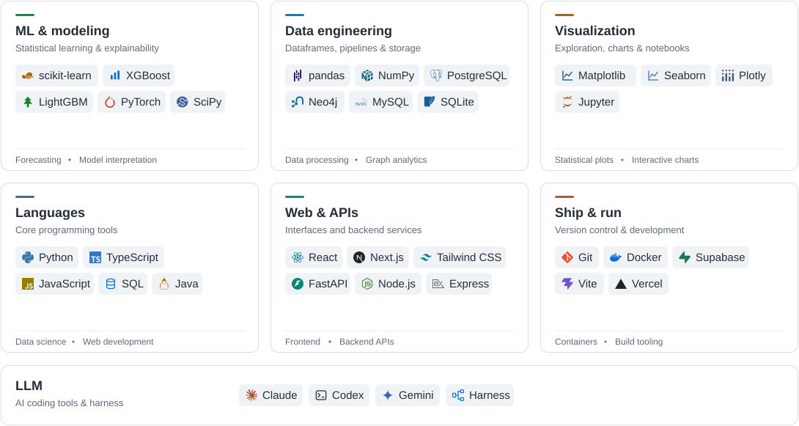

<h1 align="center">Hi, I'm Đức Anh 👋</h1>

  Data Science student at HCMIU 
  Exploring statistics, machine learning, data engineering, and AI.

  <a href="https://ducanhportfo.netlify.app">Portfolio</a>
  &nbsp;·&nbsp;
  <a href="#" title="LinkedIn link coming soon">LinkedIn</a>
  &nbsp;·&nbsp;
  <a href="#" title="Upwork link coming soon">Upwork</a>

<!-- Replace href="#" on LinkedIn and Upwork with your profile URLs when ready. -->

## 🔭 About me

I enjoy turning practical questions into reproducible analyses and useful tools. My projects explore demand forecasting, model interpretation, and dashboards that make results easier to understand.

I'm interested in Data Science and Applied ML internship opportunities.

## 📌 Selected projects

| Project | Focus | Explore |
| --- | --- | --- |
| **DataStorm / SmartGrocy** | Demand forecasting with XGBoost quantile regression, inventory planning, and BI dashboards. | [Case study](https://ducanhportfo.netlify.app/case-study-smartgrocy.html) |
| **FashionCart** | AI-assisted fashion marketplace with virtual try-on, recommendation logic, and FastAPI services. | [Case study](https://ducanhportfo.netlify.app/case-study-fashioncart.html) |
| **TODOxSKILLPATH** | Tasks, goals, and weekly planning in a React/TypeScript application backed by Supabase. | [Case study](https://ducanhportfo.netlify.app/case-study-todoxskillpath.html) |

## 🛠️ Technologies

<!-- Transparent SVG cards with GitHub light/dark palettes and a mobile layout. -->
<picture>
  <source media="(prefers-color-scheme: dark) and (max-width: 640px)" srcset="./assets/tech-stack-mobile.svg">
  <source media="(max-width: 640px)" srcset="./assets/tech-stack-mobile-light.svg">
  <source media="(prefers-color-scheme: dark)" srcset="./assets/tech-stack.svg">
  
</picture>

## 🌱 Currently learning

- Time-series forecasting and uncertainty estimation with quantile regression.
- Model evaluation and explainability.

<!-- Manage pinned repositories in the GitHub profile's "Customize your pins" menu. -->
<!-- GitHub displays the contribution activity below the profile README automatically. -->
